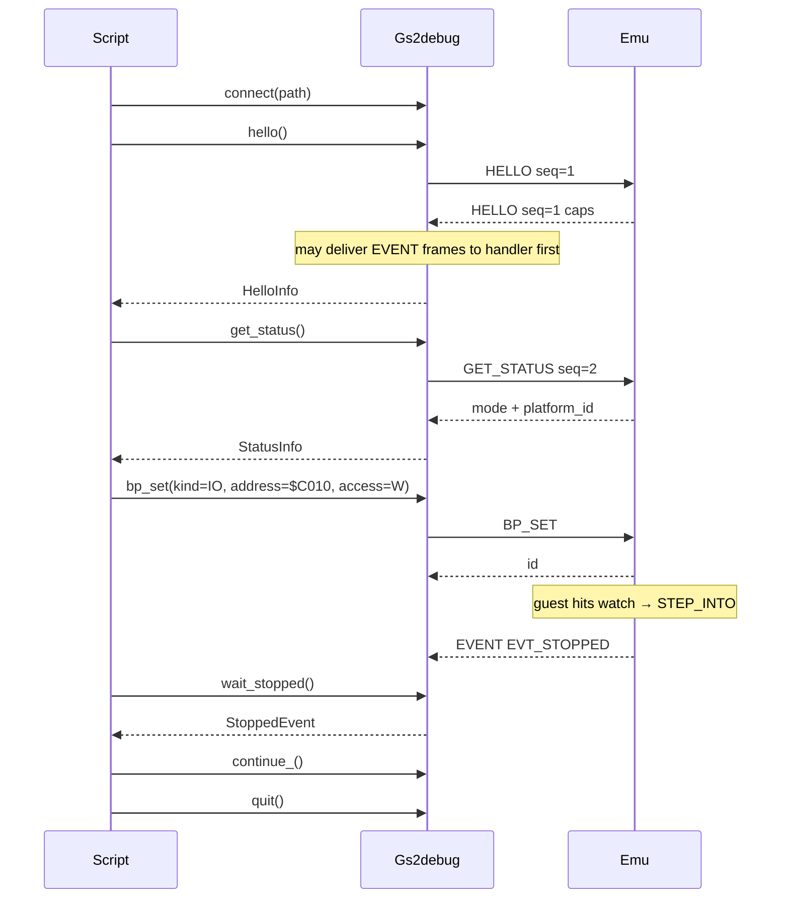

# External Debug Client

## Connected machine context

`gs2debug.context.call(client, "gs2_context_read", {"kind":"overview"})`
uses native `context` replies and also works while running, sampled on the
machine thread. `gs2_context_track` changes observer state (`on`, `off`, `mark`)
and requires explicit pause. Source-linked explanations, topology, changes,
history, clocks and snapshot receipts are documented in
[MACHINE_CONTEXT.md](MACHINE_CONTEXT.md). The same adapters are exposed by MCP;
native `Client.agent_command("context ...")` remains available directly.

## Python file-rail client

`gs2debug.CtrlClient(directory, owner=None, timeout=20)` drives an existing CTRL
or co-pilot session using native JSON replies. It is separate from the socket
`Client`. Use it as a context manager; `close()` releases its writer lease and
an explicit `command('quit')` ends the emulator. Do not mix writers on a session.

```python
from gs2debug import CtrlClient, CommandPending
with CtrlClient(control_directory) as emu:
    print(emu.cpu())
    capabilities = emu.inspect('capabilities')['data']
    memory = emu.inspect('memory', '000800', '32')
    result = emu.command('step 1')['data']
```

Commands are published atomically without overwriting another sequence. An
optional owner must match `session.json`. A timeout raises `CommandPending`
while retaining the pending sequence: call `wait()` without reissuing the
command. `CommandFailed.reply` retains a negative native verdict, including
typed counts when available; `command(..., check=False)` returns it directly.
Acknowledgements must have the expected schema, command identity and boolean
verdict. Inspection validates the artifact reference and schema and retains the
artifact in the session directory. A stale lease requires explicit cleanup by
the session owner; the client never guesses that another writer is dead.

The package is under `clients/python/src`, or can be installed from
`clients/python`. Runtime `inspect capabilities` also names the client library.

## Shared socket agent tools

`Client.agent_tools()` discovers the live command/capability registry.
`Client.agent_command(command, check=True, timeout=None)` invokes the same
handler as CTRL and returns its native JSON envelope. A negative verdict raises
`ProtocolError`; `check=False` retains it for inspection. Commands carry their
full identity and typed data where the handler supplies it. These are deliberate
tools: a command may change guest state, arm a rail or write host artifacts.

```python
client.hello()
catalog = client.agent_tools()
client.pause()
state = client.agent_command('cpu')['data']['state']
client.agent_command('ui monitor green')
result = client.agent_command('step 1')['data']
```

Ordinary tools require a paused machine. Explicit `pause` also works while
running; execution/key waits return paused, while `resume` intentionally runs.
Native context read queries also work while running at a machine-thread
boundary; `context on/off/mark` require socket pause.
Use `quit()` for acknowledged shutdown. Transport timeout is not cancellation
and does not authorize retrying a mutation. No command is evaluated by a shell.

## MCP entry point

The source-checkout adapter is `python -I tools/a2rail/mcpserver.py`; installing
the Python package also supplies `gs2-mcp`. It implements a bounded stdio tools
profile of MCP version `2025-11-25`, using newline-delimited JSON-RPC and both
structured/text results. The profile follows the official
[stdio transport](https://modelcontextprotocol.io/specification/2025-11-25/basic/transports)
and [tool result/error contracts](https://modelcontextprotocol.io/specification/2025-11-25/server/tools).
It advertises tools only; HTTP, tasks and cancellation are not implemented.

Launch an owned machine with `--exe <tested-executable> --platform 5 --out-root
<runs-directory>`, or use `--config <file.gs2>` instead of `--platform`.
Each launch creates a fresh child directory, so a fixed MCP client configuration
can restart without deleting evidence. `--out-dir <fresh-directory>` instead
chooses one explicit new session directory and refuses an existing directory.
Attach with `--socket <endpoint>`. The emulator's runtime DLL directory must
be on PATH, as for a normal launch. Managed launch pins seed 1, fake time and
default BRAM, enables `A2GSPU_AGENT=1`, verifies native bootstrap completion,
retains logs/ownership receipts and never overwrites an existing
output directory. `--seed` and repeatable `--rail NAME=value` customize startup;
rail names are checked against live discovery before serving tools. Transport,
background-window and output-root rails are reserved by the managed lifecycle.

As of 2026-10-16, `tools/list` generates 74 `gs2_<verb>` tools from the live
catalog plus `gs2_agent_tools`, `gs2_batch`, four structured debugger observations,
three artifact adapters and two context adapters (85 total). The running catalog
is authoritative. Hyphens become underscores; each native tool accepts an optional
`arguments` string containing only the verb's arguments. `gs2_pause` explicitly
pauses; ordinary tools never pause implicitly. Unknown methods/tools and
malformed requests are protocol errors, while execution refusals retain native
evidence with `isError=true`. Stdio diagnostics go only to stderr. EOF quits
only an emulator the adapter launched; an attached emulator stays alive.

Structured observations take named JSON fields, rather than the native
`arguments` string. All require explicit pause and exclusive ownership of the
session during the call:

| Tool | Fields and result |
| --- | --- |
| `gs2_trace_read` | `ago` (default 0), `count` (1..512, default 100); oldest-to-newest decoded native records, ring availability, window bounds and adjacent clock deltas |
| `gs2_memory_read` | `domain`, integer `address`, `length` (1..65536); byte values plus readability, with null for unreadable I/O |
| `gs2_memory_search` | Same memory fields, `pattern_hex`, optional equal-size `mask_hex`, `max_hits` (1..512, default 16); masked matches, capped-hit truncation and unreadable-byte count |
| `gs2_video_text_read` | `page` (0 current, 1, 2), `mode` (0 current, 1 text40, 2 text80); resolved metadata, raw characters and ASCII-ish display lines |

Memory domains are `main`, `megaii`, `ensoniq`, `adbmicro`, `main_raw` and
`megaii_raw`, with the protocol's machine/device restrictions. Bus-read domains
are deliberately excluded from read-only adapters. Probe data and readability
require separate bridge calls; exclusive paused ownership supplies consistency.
Search operates on that bounded host snapshot and never counts unreadable
placeholder bytes as matches, even under a wildcard mask. `truncated=true`
means an additional match exists beyond the returned cap.

Trace clocks are `NClock.get_cycles()` recorded at instruction entry, retained
as decimal strings to preserve uint64 precision. The first record and backward
clock transitions have no delta. Trace collection must first be armed with
`gs2_tbuf` arguments `on`. Availability describes the retained ring, not total
execution coverage; overwritten history and unarmed periods are not counted.
Neither trace clocks nor the extended text formatter
infer video phase; scanline/VBL need independent video observations. Text page
bytes preserve high-bit glyph codes; decoded lines are a convenience and do
not represent graphics pixels. These adapters add no new socket types or CTRL
verbs. Trace data/effective-address/write fields describe the native record's
last operand access; they are not a complete bus-cycle trace.

## Evidence and input transport

An MCP-only agent can now complete the file-based parts of the development
loop without a separate filesystem tool:

1. `gs2_artifact_put` accepts `path`, required `sha256`, and exactly one
   `text` or strict `base64` value. It creates a new input file atomically,
   at most 512 KiB decoded, and refuses overwrite or a digest mismatch.
2. Pass its returned path explicitly to `gs2_load`, `gs2_mount`, or another
   native command. `load` supports quoted paths with spaces and rejects extra
   or malformed arguments before writing guest memory.
3. Run, then gate on `gs2_assert` or another measured verdict. An emulator
   command succeeding is distinct from the guest satisfying its goal.
4. `gs2_artifact_list` discovers files and batch directories. It lists one
   directory at a time, with `offset`/`limit` pagination (maximum 256 results,
   4096 directory entries); it never follows links while listing.
5. `gs2_artifact_read` returns bounded bytes, SHA256, range/completeness and
   provenance metadata. Native 8-bit noninterlaced PNGs become actual MCP
   `image` content; strict UTF-8 becomes text; binary can use `mode=base64`.
   `sha256` optionally requires an expected digest of the returned bytes.

Managed launch defaults artifact access to its own new output directory,
including cold-batch subdirectories. Attach has no implicit filesystem scope;
use `--artifact-root <existing-directory>` explicitly. A supplied artifact root
also overrides the managed default. Paths can be relative or absolute inside
that selected root; parent traversal/outside-root resolution and alternate
data streams refuse. This is the artifact adapter's scope; native commands
continue to honor their explicitly supplied paths.

Reads are limited to 1 MiB. For larger files choose an explicit integer
`offset` and `length`; the digest then covers only that returned range.
`complete` means the entire file **at that read**, not proof its producer has
finished. Stable metadata during a read is checked; active sinks may append
later. Close capture/subscription producers before final assertions. Image
preview validates chunks/CRC, bounded deflate length and filter tags, and
supports at most four million pixels; other formats can be retrieved as
base64. That validation does not prove display color-model equivalence.

Artifacts remain accessible after `gs2_quit` while the stdio adapter is alive.
The managed `mcp-session.json` receipt includes the selected executable's
launch-time SHA256 and native bootstrap proof. It does not capture every
runtime asset, disk or external endpoint, and is not a replay capsule.

## Recovering a timed-out socket command

`RequestPending` (a `TimeoutError`) means a complete request was sent and its
original outcome remains unknown. Partial headers/payloads are retained, and
new requests are blocked without allocating or sending another sequence.
Inspect `Client.pending_request`, then call `wait_agent_command(timeout=...)`
for a native agent command or `wait_response(timeout=...)` for raw reply bytes.
The original command identity is checked on agent recovery. These methods
never resend the mutation. Event waits preserve partial framing as well;
unrelated events do not restart a stop/record wait's deadline.

During request/reply handling, a send failure or terminal receive/framing error
closes the socket because a
partly published frame cannot be resumed safely. Disconnect still does not
prove cancellation; reconnect and inspect evidence before deciding what to do.
The SDK is synchronous, with one reader/request owner. This is not a remote
transaction, automatic reconnect, cancellation, or mutation-retry facility.
The file client likewise rejects control characters before publication and
keeps its existing pending-sequence recovery through `wait()`.

## Output failures

Native `status=FAIL output-io` can follow guest execution or a partial host-file
write. It does not roll back a command; inspect state and retained evidence
before deciding whether to retry. A failed global record sink can keep commands
failing and requires a fresh session; native QUIT still permits owned shutdown.
Global/tap late-finalization failure exits 2. A successful QUIT acknowledgement
alone does not establish complete output: check the process exit and explicit
stream close/status. Buffered record counts and observer notifications can
precede a later close failure. See the
[output-sink audit](reports/gssquared-sink-io-20261016/README.md) for covered
writers and the emergency exit limitation. The subsequent
[per-rail/ACK continuation](reports/gssquared-rail-close-20261016/README.md)
checks registered per-rail shutdown and additional synchronous exports. It
closes registered outputs before destroying the clock, attempts all closures
and exits 2 if any fail. Live close failures consume the old stream.

File ACK publication uses a checked temporary write/flush/close and rename.
An existing `ack.N` is preserved and refused: use a fresh session directory
and increasing sequences. Failure prints `ack-publication`, sequence and
`effects=may-have-occurred`, then exits 2. The command may already have run;
absence of its receipt is not permission to resend. Inspect the session log,
process exit and artifacts. A completed temporary file can remain when rename
fails. This is not fsync or a concurrent-writer no-clobber guarantee.

## Managed close-out

`Client.quit(timeout=seconds)` optionally bounds the QUIT reply wait; omitting
it retains the SDK's existing unbounded wait. A reply timeout leaves that same
request pending. The MCP backend uses a two-second QUIT reply budget, then a
ten-second exit wait after acknowledgement. With a pending request it sends
no replacement QUIT: it disconnects, waits up to two seconds and, if necessary,
kills and waits up to five seconds for its own `Popen` child. An unacknowledged
closing QUIT uses that same shorter exit path. These are individual wait
budgets, not a hard deadline on host scheduling or receipt filesystem I/O.
An attached backend only disconnects and never quits or kills its external owner.
Close begins when the synchronous server reaches EOF/error cleanup; it does not
interrupt a currently blocked tool handler or provide concurrent cancellation.

Managed `mcp-session.json` adds `shutdown` (null while no close has begun),
with schema `a2mcp-shutdown-v1`:

| Field | Meaning |
| --- | --- |
| `owned` | This backend actually launched the process |
| `pending_request` | Sequence/type/effect captured before disconnect clears transport state; may also name an unanswered closing QUIT |
| `effects_unknown` | A request was unresolved at close, or the closing QUIT failed; disconnect/termination does not recover its result |
| `quit_attempted`, `quit_acknowledged` | Closing QUIT was attempted, and an empty native reply was received (including a prior explicit `gs2_quit`) |
| `transport_closed` | The client transport was closed |
| `forced_termination` | The backend used its owned child's `kill()` fallback |
| `outcome` | `incomplete`, `owned-exited`, `owned-terminated`, `already-exited` or `attached-disconnected` |
| `errors` | Named errors caught during close, separate from native exit status |

The outer `closed` and `exit_code` remain authoritative for actual process
termination. They do not prove guest correctness, successful pending effects,
complete artifact flushes or hardware fidelity. This object describes close-out,
not a complete command history. Repeated close preserves unresolved identities
and completed receipt bytes. Failed reap/receipt I/O remains a real error;
`closed` is false if the owned process is still alive. Attached sessions do not
write a managed owner receipt into an external artifact root.

The agent bootstrap reuses interactive CTRL instrument initialization, starts
paused and suppresses host preferences/input. Pacing/coverage startup effects
and native mode proof are tested; launch success is not inferred from an
environment variable. One-shot-only rails (assert/golden, boot-load/run, final
dumps and microtests) refuse interactive `--rail` with a redirect to `gs2_batch`.

`gs2_batch` takes structured `frames` (1..1,000,000), optional `rails` string
map, `platform` or `config`, and `timeout_seconds` (1..300; default 60). It runs
a separate cold one-shot child in a fresh directory and returns native exit
status, timeout, retained log/artifact paths and explicit excerpt completeness.
Exit zero means emulator completion; supply assertion/golden rails to establish
guest behavior. Batch jobs leave the current machine untouched and require a
managed `--exe` server. They are not checkpoint branches or replay.
CPU/RAM is separate; disks and host endpoints follow the selected configuration.

Configure the command/arguments above in the chosen MCP client. Shipping this
adapter does not silently install or change an AI application's configuration.

## Socket event streams

After `Client.connect()` and `hello()`, `manifest()` discovers requests and
subscription kinds. Use `subscribe(('stop', 'irq', 'device'), queue_cap=1024)`
and an `on_event` callback to collect `EVT_AGENT_RECORD` payloads (UTF-8 JSON).
`wait_agent_record()` also reads a record synchronously. `subscription_status()`
and `unsubscribe()` return native loss/completeness counts; unsubscribe drains
queued events through the callback before returning. Retained means enqueued,
so compare received sequences/counts as well. See the protocol contract for
sampling limits. This is independent of `CtrlClient` and file subscriptions.

Host-side client library for [DebugProtocol.md](DebugProtocol.md). Wire format lives in the protocol doc; this document covers language choice, library shape, API, and client-side concerns so agents and scripts do not re-implement framing from scratch.

Python package lives under [`clients/python/`](../clients/python/) (`gs2debug`). Wire format: [DebugProtocol.md](DebugProtocol.md).

**Agent / script cookbook (preferred entry point):** [gs2debug.md](gs2debug.md).

## Language: Python 3

**Python 3.10+** is the first (and primary) client language.

Why:

- Stdlib `socket` covers AF_UNIX (macOS / Linux) and TCP with no dependencies; Windows AF_UNIX works on recent Python + Windows 10+.
- Agents and CI scripts already default to Python; extending framing with `struct` / `socket` is straightforward.
- No build step — drop a script next to the package and call `Client`.
- Matches the protocol direction: host-driven tools with typed binary commands
  and native JSON discovery/agent records.

A later TypeScript (or other) client can share the same wire rules from the protocol doc (e.g. for MCP). This sketch does not define those APIs.

You do not need deep Python experience to use the library; agents and the package own most of the protocol detail.

## Responsibilities

| Layer | Owns |
|-------|------|
| [DebugProtocol.md](DebugProtocol.md) | Frame bytes, type IDs, payload layouts |
| Client library (`gs2debug`) | Connect, framing read/write, seq allocation, HELLO, request/reply matching, ERROR → exception, EVENT demux, thin helpers (`read_mem`, `reset`, `bp_set`, `wait_stopped`, `type_text`, `paste_text`, `quit`, …) |
| Agent / script | Workflows (reset → type → peek → …), timeouts, retries, policy |

The emulator owns machine state. The client peeks/pokes memory via READMEM / WRITEMEM, resets via RESET, run-controls via PAUSE / CONTINUE, sets breakpoints via BP_*, injects keys via KEYEVENT, fills the paste buffer via PASTE_TEXT, and force-exits via QUIT.

## Package layout

```
clients/python/
  README.md
  pyproject.toml          # package name gs2debug, requires-python >= 3.10, no runtime deps
  src/gs2debug/
    __init__.py
    types.py              # HELLO / PING / QUIT / GET_STATUS / RESET / PAUSE / CONTINUE /
                          # READMEM / WRITEMEM / BP_* / KEYEVENT / PASTE_TEXT / EVT_* / STOP_* / MEM_* constants
    keys.py               # SDL scancodes / keymods + ASCII→key map for type_text
    frame.py              # pack / unpack 12-byte header + payload
    client.py             # Client, HelloInfo, StatusInfo, BpInfo, StoppedEvent, TraceWindow
    errors.py             # ProtocolError from ERROR frames
  examples/               # hello_ping, read/write text40, type_to_emu, test_breakpoints,
                          # watch_data_iigs, watch_c010_iie, …
  tests/
    test_frame.py         # encode/decode roundtrips (no socket server needed)
```

Stdlib only: `socket`, `struct`. Optional later: `threading` / `selectors` for a background event reader.

## Client API

```python
from collections.abc import Callable
from dataclasses import dataclass

@dataclass(frozen=True)
class HelloInfo:
    version: int
    flags: int
    max_payload: int

@dataclass(frozen=True)
class StatusInfo:
    execution_mode: int  # 0=NORMAL, 1=STEP_INTO, 2=PAUSED
    platform_id: int     # PlatformId_t / -p N (0=II … 5=IIgs)

@dataclass(frozen=True)
class BpInfo:
    id: int
    hit_count: int
    kind: int            # BP_KIND_EXEC / DATA / IO
    flags: int
    access: int          # BP_ACCESS_*
    domain: int
    address: int
    length: int
    addr_mask: int
    data_value: int
    data_mask: int
    ignore_count: int

@dataclass(frozen=True)
class StoppedEvent:
    reason: int          # STOP_BP_EXEC / DATA / IO / STOP_STEP / STOP_PAUSE
    bp_id: int
    pc: int
    eaddr: int
    value: int
    access: int
    kind: int
    execution_mode: int
    trace: bytes         # 40-byte system_trace_entry_t snapshot when present

@dataclass(frozen=True)
class TraceWindow:
    available: int       # entries currently in the ring
    entries: list[bytes] # oldest → newest; each len == 40

class Client:
    def connect(self, path: str) -> None:
        """Connect to a Unix-domain socket at path. TCP later."""

    def close(self) -> None:
        """Close the connection."""

    def hello(self, version: int = 1) -> HelloInfo:
        """Send HELLO; return server caps. Required before other commands."""

    def ping(self) -> None:
        """Send PING; succeed if empty PING reply arrives."""

    def quit(self, *, timeout: float | None = None) -> None:
        """Force-quit emulator (skips QuitModal / dirty-disk prompts).
        Prefer over kill/SIGTERM. If a harness must SIGTERM, start GSSquared
        with --no-quit-confirm."""

    def get_status(self) -> StatusInfo:
        """Send GET_STATUS; return execution_mode and platform_id.
        Handled on the emulator main thread. Reply is 8 bytes on the wire."""

    def reset(self, cold_start: bool = False) -> None:
        """Send RESET; call computer_t::reset(cold_start) on the main thread.
        cold_start=True clears $3F2–$3F4 before reset. Does not clear breakpoints."""

    def pause(self) -> None:
        """PAUSE: stop guest execution (STOP_PAUSE / EXEC_PAUSED)."""

    def continue_(self) -> None:
        """CONTINUE: resume from PAUSE or STEP_INTO (EXEC_NORMAL)."""

    def step_into(self, count: int = 1) -> None:
        """STEP_INTO: run `count` instructions (instructions_left); empty reply.
        When the batch finishes: EVT_STOPPED STOP_STEP + CPU trace. count >= 1."""

    def get_trace(self, ago: int = 0, count: int = 100) -> TraceWindow:
        """GET_TRACE: ring window. ago=0 is newest; count extends into the past.
        Returns TraceWindow(available, entries) — each entry is 40 raw bytes."""

    def state_get(self, device_id: int) -> bytes:
        """STATE_GET: opaque device snapshot for DEVICE_ID_* (e.g. DEVICE_ID_ENSONIQ)."""

    def bp_set(
        self,
        *,
        kind: int,
        address: int,
        length: int = 1,
        flags: int = BP_FLAG_ENABLED,
        access: int = BP_ACCESS_NONE,
        domain: int = 0,
        addr_mask: int = 0xFFFFFFFF,
        data_value: int = 0,
        data_mask: int = 0xFF,
        ignore_count: int = 0,
    ) -> int:
        """BP_SET; return new breakpoint id. See DebugProtocol.md for kind/access rules.
        EXEC: access ignored. DATA/IO: access R/W/RW required. IO: $C000–$C0FF offset."""

    def bp_clear(self, bp_id: int) -> None:
        """BP_CLEAR one id."""

    def bp_clear_all(self) -> None:
        """BP_CLEAR_ALL (shared table with the built-in debugger)."""

    def bp_enable(self, bp_id: int, enabled: bool = True) -> None:
        """BP_ENABLE / disable by id."""

    def bp_list(self) -> list[BpInfo]:
        """BP_LIST; return current table entries."""

    def wait_event(self, *, timeout: float | None = 5.0) -> tuple[int, int, bytes]:
        """Block until an EVENT frame. Returns (event_id, seq, data).
        Raises TimeoutError on deadline. Cannot run while a request is outstanding."""

    def wait_stopped(self, *, timeout: float | None = 5.0) -> StoppedEvent:
        """Block until EVT_STOPPED; parse and return StoppedEvent.
        Skips other event ids (e.g. EVT_RUN_STATE) until a stop arrives."""

    def read_mem(self, domain: int, address: int, length: int) -> bytes:
        """Send READMEM; return `length` bytes from the given domain/address.
        Domains: MAIN, MAIN_RAW; MEGAII / MEGAII_RAW on Apple IIgs.
        ENSONIQ/ADBMICRO reserved. Handled on the emulator main thread."""

    def write_mem(self, domain: int, address: int, data: bytes) -> None:
        """Send WRITEMEM; poke `data` at domain/address.
        Domains: MAIN, MAIN_RAW; MEGAII / MEGAII_RAW on Apple IIgs.
        ENSONIQ/ADBMICRO reserved. Handled on the emulator main thread. Success reply is empty."""

    def key_event(self, down: bool, scancode: int, mod: int = 0) -> None:
        """Send KEYEVENT (one SDL key down or up)."""

    def key_down(self, scancode: int, mod: int = 0) -> None:
        """KEYEVENT down. Use for modifiers and low-level control."""

    def key_up(self, scancode: int, mod: int = 0) -> None:
        """KEYEVENT up."""

    def tap_key(self, scancode: int, mod: int = 0, *, hold_s: float = 0.02) -> None:
        """keydown, optional hold, then keyup with the same scancode/mod."""

    def type_text(self, text: str, *, delay_s: float = 0.05, hold_s: float = 0.02) -> None:
        """Type printable ASCII (US layout); newline → Return.
        hold_s between down/up; delay_s after each char (3× after Return)."""

    def paste_text(self, text: str) -> None:
        """Fill the emulator paste buffer (PASTE_TEXT). One round-trip; guest paces drain.
        Replaces any in-progress paste. Empty string cancels. Prefer over type_text for long strings."""

    def request(
        self,
        type: int,
        payload: bytes = b"",
        *,
        timeout: float | None = None,
    ) -> bytes:
        """Send one request; return reply payload. Raises ProtocolError on ERROR."""

    def on_event(
        self,
        handler: Callable[[int, int, bytes], None] | None,
    ) -> None:
        """Register handler(event_id, seq, data) for EVENT frames. None clears.
        Also invoked for EVENTs interleaved while a request awaits its reply."""
```

Generic `request` keeps payloads as `bytes`. Original debugger helpers pack/unpack
documented fields with `struct`; manifest/shared-agent helpers decode their
explicit native JSON payloads. MCP JSON-RPC is a separate host-side layer.

Constants (`BP_KIND_*`, `BP_ACCESS_*`, `BP_FLAG_*`, `EVT_*`, `STOP_*`, `EXEC_*`, `MEM_*`, `PLATFORM_*`) are re-exported from `gs2debug` / `gs2debug.types`. Breakpoint semantics: [DebugProtocol.md](DebugProtocol.md) (EXEC / DATA / IO, masks, ignore_count, STOP reasons).

### Behavioral rules

1. **Connect + HELLO first.** Any other command before a successful `hello()` is a client bug; server may reply `ERROR` with `E_NOT_HANDSHAKED`. Surface `E_BAD_VERSION` / `E_NOT_HANDSHAKED` as `ProtocolError`.
2. **Single-flight v1.** At most one outstanding `request` at a time. Library allocates monotone non-zero `seq` (start at 1). `wait_event` / `wait_stopped` also require no outstanding request.
3. **Reply matching.** After send, read frames until a non-`EVENT` frame with matching `seq`:
   - `type == ERROR` → raise `ProtocolError(code, message)`
   - `type` equals the request type → return payload
   - otherwise → protocol violation (raise)
4. **EVENT while waiting.** If an `EVENT` frame arrives before the reply, invoke `on_event` (if set), then keep waiting for the reply. Events must not break request/reply pairing. Prefer `wait_stopped()` when idle for stop notifications.
5. **Timeouts.** `request(..., timeout=seconds)` / `wait_event` / `wait_stopped` raise `TimeoutError` on deadline. Connection failures raise clearly (`OSError`).
6. **Threading (v1).** Sync API on the caller thread. A background reader for events while idle is a later enhancement.
7. **Breakpoint hit → STEP_INTO.** A DATA/IO/EXEC hit (and PAUSE) leaves the emu in `EXEC_STEP_INTO` or `EXEC_PAUSED` until `continue_()` or `step_into(n)`. Scripts that want a visible pause must delay before resume. `step_into(n)` arms N instructions and delivers `STOP_STEP` when done.
8. **Quit cleanly.** Prefer `quit()` over killing the process (SDL maps SIGTERM to QuitModal unless `--no-quit-confirm`).

### Errors

```python
class ProtocolError(Exception):
    code: int       # E_* from the protocol doc
    message: str    # UTF-8 text from ERROR payload (may be empty)
```

Map known codes (`E_UNKNOWN_TYPE`, `E_BAD_LENGTH`, …) in docs or constants; agents can branch on `code`.

## Client-side concerns

Implementers and agents must handle these; do not reinvent per script:

| Concern | Rule |
|---------|------|
| Partial I/O | Loop `recv`/`send` until the full 12-byte header and `N` payload bytes are transferred |
| Endianness | Little-endian: `struct.pack("<III", type, seq, length)` / `unpack` |
| Max payload | 1 MiB (`0x00100000`). Refuse to send or accept larger frames |
| Connection model | One client connection; reconnect = new `Client` |
| Socket path | AF_UNIX path for now (e.g. `/tmp/gs2.sock`). Windows named pipes / TCP later |
| Unknown events | Ignore unknown `event_id` values (handler may no-op); `wait_stopped` skips non-`EVT_STOPPED` |
| Encoding | Payloads are `bytes`; helpers use `struct` for packed fields and JSON for documented manifest/agent extensions |

## Smoke-test story

The socket and client are implemented. Unit framing tests supplement the native
integration checks; they do not stand in for an emulator round trip:

1. Start GSSquared with `--debug PATH` (or `-D PATH`), e.g. `-p 3` for IIe Enhanced / `-p 5` for IIgs.
2. `Client().connect(path)` → `hello()` → `get_status()` (check `platform_id`) → `reset()` / `read_mem` / `paste_text` / `type_text` / `bp_*` / `wait_stopped` → `quit()`.
3. Assert caps and that `platform_id` matches the launched `-p N`.
4. Prefer `c.quit()` over `kill` (see [AGENTS.md](../AGENTS.md) debug-protocol smoke notes).

**Self-launching examples** (spawn GSSquared, exercise protocol, quit):

| Script | Role |
|--------|------|
| `examples/test_breakpoints.py` | PAUSE/CONTINUE + EXEC/IO + cap (expects running emu + socket args) |
| `examples/watch_data_iigs.py` | Launch `-p 5`, DATA watch, print stop packet, QUIT |
| `examples/watch_c010_iie.py` | Launch `-p 3`, IO write `$C010`, hold in STEP, CONTINUE, QUIT |

## Non-goals (v1 client)

- Async API, pipelining, TCP connect. The stdio MCP adapter is a separate
  companion described above; it is implemented.
- Expression-language breakpoints (host owns policy; emu is typed stops only)

## Flow



# Example Commands

```
./build/GSSquared --debug /tmp/gs2.sock -p 3
PYTHONPATH=clients/python/src python3 clients/python/examples/hello_ping.py /tmp/gs2.sock

PYTHONPATH=clients/python/src python3 clients/python/examples/watch_c010_iie.py
PYTHONPATH=clients/python/src python3 clients/python/examples/watch_data_iigs.py 02/0000
```
